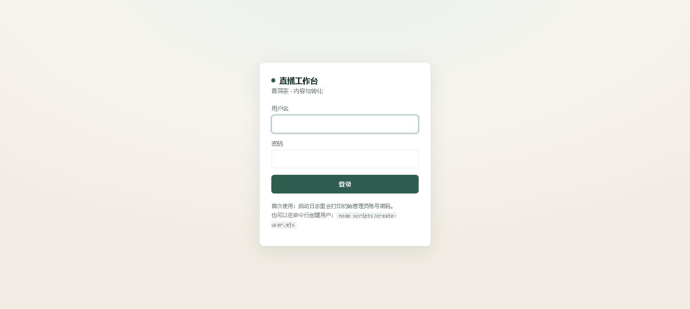
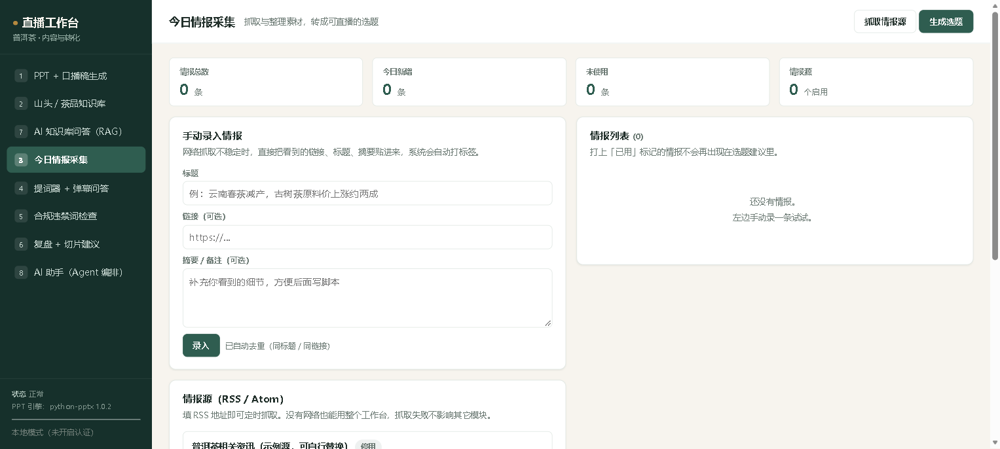

# 多租户与身份认证（第 10 周 Day 1–2）

> 把"我一个人用的工具"改造成"能同时服务多个茶商、数据互不可见"。
>
> 这一步**不改任何 AI 功能**，只换数据视角：从"我的数据"变成"每个租户的数据 + 谁能访问"。

---

## 一、现在是什么状态

| 能力 | 状态 | 验收 |
| --- | --- | --- |
| 数据按租户隔离（知识库/问答/方案/审计/导出物） | ✅ Day 1 | `node scripts/tenant-smoke.mjs` → 31/0 |
| 身份只来自 token（伪造参数无效） | ✅ Day 2 | `node scripts/auth-smoke.mjs` → 26/0 |
| 租户注册表 / 停用 / 移除 | ✅ Day 2 | 同上 |
| token 只存哈希、撤销即时生效 | ✅ Day 2 | 同上 |
| 安全护栏：多租户 + 无认证 = 拒绝启动 | ✅ Day 2 | 同上 |
| **角色权限（viewer/editor/approver）** | ✅ Day 4 | `node scripts/rbac-smoke.mjs` → 30/0 |
| **写操作 pending 跨租户隔离** | ✅ Day 4 | 同上 |
| **审计可追责（tenantId/actor/role）** | ✅ Day 4 | 同上 |
| **配额计数 + 超限 429** | ✅ Day 5 | `node scripts/quota-smoke.mjs` → 31/0 |
| **成本报表（真实用量）** | ✅ Day 5 | `node scripts/quota-report.mjs` |
| **登录界面 + 会话 cookie** | ✅ Day 11 | `node scripts/auth-ui-smoke.mjs` → 35/0 |
| 用户管理界面 | ⬜ 命令行已可用 | `node scripts/create-user.mjs` |

---

## 二、目录布局

```
data/
├── tenants.json              ← 租户注册表（平台级）
├── tokens.json               ← token 表（平台级，只存 sha256 哈希）
├── eval/                     ← 评测资产（平台级，不属于任何租户）
└── tenants/
    ├── default/              ← 迁移后的原数据
    │   ├── knowledge.json / compliance.json / faq.json / sessions.json / intel.json / sources.json / settings.json
    │   ├── decks/ seed/ backups/
    │   └── agent-audit.jsonl
    └── tenant_a/  …          ← 新租户，结构同上

output/
└── tenants/
    ├── default/{pptx,scripts,html,agent}/
    └── tenant_a/…
```

**为什么 `tenants.json` / `tokens.json` 在 `data/` 根下而不是某个租户目录里**：
它们要在租户上下文建立**之前**就能读。放租户目录会死锁 ——
"要先知道租户才能查 token，要先有 token 才能知道租户"。

---

## 三、两种运行模式

| 模式 | 触发 | 行为 |
| --- | --- | --- |
| `local`（默认） | 未设 `WORKBENCH_AUTH` | 单用户本地工具。所有请求以 `default` 租户 + `approver` 角色运行 |
| `required` | `WORKBENCH_AUTH=required` | `/api/*`（除 health）和 `/files/*` 必须带有效 token |

### 为什么默认是 local

这个工具默认是"自己店里一个人用"。硬要 token 会让现有 UI 和全部测试当场挂掉，
而那些人并没有多租户需求。

### 安全护栏（这条很关键）

**一旦注册表里有 >1 个启用租户，且认证没开 → 服务拒绝启动。**

```
✗ 拒绝启动：检测到多个启用租户，但没有开启身份认证
  当前启用租户（3 个）：default, tenant_a, tenant_b
  没有认证时，所有请求都会落到 default 租户 —— 多租户等于没做。

  开启方式（PowerShell）：
    $env:WORKBENCH_AUTH = "required"
    node server/index.mjs
```

理由：这是唯一一个"看起来能跑、实际上所有人都在同一个租户里"的配置。
不做护栏的话，用户建了 `tenant_b` 却忘了开认证，数据全写进 `default`，**而且不会报错**。
这种静默失败比启动失败危险得多。

---

## 四、怎么用

### 本地单用户（默认，不用改任何东西）

```powershell
npm start
```

### 多租户模式

```powershell
# 1. 开认证启动。首次启动会自动生成 owner token 并打印一次
$env:WORKBENCH_AUTH = "required"
node server/index.mjs

# 输出里会有：
#   ┌──────────────────────────────────────────────────────────┐
#   │ 已自动生成初始 owner token（只显示这一次，请立即保存）    │
#   └──────────────────────────────────────────────────────────┘
#   wb_f4oD3QVqQCW5mLoKWOgw7z-S2JPLE4cHkQFMbPBpVLk
#   租户：default  角色：approver  用户：owner

# 2. 带上它调接口
curl -H "Authorization: Bearer wb_..." http://127.0.0.1:8788/api/kb/stats
```

> **明文只在生成时出现一次**，`data/tokens.json` 里只存 sha256 哈希。
> 系统自己也拿不回明文 —— 丢了就撤销重建。

### 管理租户与 token

```js
import { upsertTenant, removeTenant, disableTenant, listTenants } from './server/lib/tenants.mjs';
import { createToken, listTokens, revokeToken } from './server/lib/auth.mjs';

// 新增租户
upsertTenant({ id: 'shop_b', name: 'B 茶店' });

// 发 token（返回的 raw 只显示这一次）
const { raw, record } = createToken({ tenantId: 'shop_b', userId: 'bob', role: 'editor' });

// 停用（数据还在，token 立即失效）
disableTenant('shop_b');

// 撤销某个用户的所有 token
revokeToken({ userId: 'bob' });
```

---

## 五、三个核心设计决策

### 决策 1：身份只能来自 token

```js
// ❌ 改一个参数就能读别人的数据
const tenantId = body.tenantId || req.headers['x-tenant-id'];

// ✅ 唯一正确来源
const { tenantId } = verifyToken(bearerToken(req));
```

`auth-smoke.mjs` 里专门有测试：带 A 的 token + `X-Tenant-Id: tenant_b` + `body.tenantId`，
**读到的必须仍是 A 的数据**。

### 决策 2：`AsyncLocalStorage` 传上下文，不给每个函数加参数

一次请求穿几十层函数（handler → loadKB → readJson → paths…）。加 `tenantId` 参数要改几十个签名，
**漏改一个就是静默越权**，而且现有 100+ 项测试全要改。

`AsyncLocalStorage` 让租户身份像隐式参数一样贯穿调用链，签名一个不改。

**代价是隐式依赖**，所以配一条硬规则：

> **只有 `paths.mjs` 和 `store.mjs` 允许读租户上下文。业务模块一律不读。**

### 决策 3：租户级路径必须是函数，不能是常量

```js
// ❌ 模块顶层求值 → 只在 import 时算一次，之后永远是那个租户的目录
const FAQ_FILE = path.join(dataDir(), 'faq.json');

// ✅ 每次调用时求值
const faqFile = () => path.join(dataDir(), 'faq.json');
```

这个错误**不会报错**，只会让所有租户读到同一个文件。是多租户最隐蔽的 bug 来源。

---

## 五之二、角色权限与审计（Day 4）

### 三种角色

| 角色 | 能读 | 能**提议**写操作 | 能**批准**写操作 | 典型使用者 |
| --- | --- | --- | --- | --- |
| `viewer` | ✅ | ❌ | ❌ | 看方案、查知识库的新人 |
| `editor` | ✅ | ✅ | ❌ | 主播、运营（可以提议存问答） |
| `approver` | ✅ | ✅ | ✅ | 店长（拍板的人） |

**分工的意义**：`editor` 能生成待确认卡片（"我想存这条问答"），但**点不了确认**。
批准必须由 `approver` 做 —— 提建议的人和拍板的人分开，这正是两阶段提交在组织层面的对应。

### pending 必须按租户隔离（这条最容易漏）

`actionId` 是「工具名 + 参数」的哈希，**不含租户**。
两个租户提出**参数完全相同**的写操作时，会算出**同一个 actionId**。

如果 pending 表按 actionId 直接存，后果是：
- A 的动作被 B 覆盖
- B 能用猜到的 actionId 确认 A 的动作

所以内部 key 是 `${tenantId}:${actionId}`，`listPending` / `getPending` / `confirmPending` 全部按当前租户过滤。
**实测：B 的 approver 拿 A 的 actionId 去确认 → 404。**

### 审计必须能追到"谁"

每条审计记录现在都带三个字段，由上下文**自动补齐、不接受调用方传入**：

```json
{ "at": "...", "kind": "execute", "tool": "save_faq", "actionId": "...",
  "tenantId": "tenant_a", "actor": "u_approver", "role": "approver", "ok": true }
```

企业追责问的是"**谁**批的"，不是"哪个租户批的"。
没有 `actor` 的审计只能证明"某租户执行过写操作"，等于无法追责。

### 一个容易漏的绕过路径：`/api/agent/run` 里的 `approvals`

`/api/agent/run` 支持直接带 `approvals` 执行（前端确认后走的另一条路）。
如果不加限制，`editor` 可以在自己的请求里塞 `approvals: [自己的 actionId]`，**自己批准自己**。

现在的规则：**只有 `approver` 才允许通过 `approvals` 直接批准**，其他角色传了也被忽略。
`rbac-smoke` 里有专门一条测这个。

---

## 五之三、配额与成本（Day 5）

AI 功能**按 token 计费**。企业采购一定会问两件事：「一个月花多少钱？」「有人滥用怎么办？」
这一层就是回答它们的。

### 设计

- **限额**来自注册表 `data/tenants.json` 的 `quota` 字段（管理员配）
- **用量**落在 `data/tenants/<id>/quota-usage.json`（租户级，隔离自动生效）
- **只统计真正花钱的入口**：`/api/kb/ask` 和 `/api/agent/run`。
  `/api/kb/search` 不调模型，不计费 —— **记账口径要跟成本口径一致**。
- **检查在调用模型之前**：超限时一分钱都不花，也方便测 429 不用真跑模型。

### 自动重置

| 周期 | 重置什么 | 怎么实现 |
| --- | --- | --- |
| 跨天 | 调用次数归零 | 读用量时比对日期，不一致就归零（不做定时任务） |
| 跨月 | token 归零 | 同上 |

> 为什么不用定时任务：漏跑一次定时任务就会导致"额度不重置"。
> **读时顺手重置**没有这个失败模式。

### 成本报表

```powershell
node scripts/quota-report.mjs
```

真实跑两次调用后的输出（本项目实际数据）：

```
租户        状态        今日调用        本月 token      本月成本   单次成本
──────────────────────────────────────────────────────────────────────
default    active     2 / 2000     9239 / 2000000    ¥0.0100   ¥0.0050

月度外推（按今天 × 30）：60 次调用 / 277170 token / ¥0.30/月
```

**关键数字：单次调用约 ¥0.005。**

### 单价说明（诚实标注）

| 项目 | 值 | 依据 |
| --- | --- | --- |
| 输入 | ¥1 / 百万 token | 有实测依据（`docs/research/deepseek-capability.md` §4，空闲时段） |
| 输出 | ¥2 / 百万 token | ⚠️ **假设值**，未实测。请按官方价格页校正 |

用环境变量覆盖：

```powershell
$env:COST_IN_PER_MTOK = "1"
$env:COST_OUT_PER_MTOK = "2"
node scripts/quota-report.mjs
```

### 一个真实的成本发现

实测两次调用：

| 入口 | prompt token | completion token |
| --- | --- | --- |
| `/api/kb/ask` | 1438 | 169 |
| `/api/agent/run`（2 轮） | 7041 | 591 |

**Agent 的输入 token 是 RAG 的 5 倍。** 原因：工具定义（7 个工具的完整 description）+ 每轮对话历史都要重发。
这直接决定了定价策略 —— Agent 功能不该和 RAG 问答卖同一个价。

> 顺带印证：`prompt_cache_hit_tokens: 1280`，说明 prompt 缓存生效了，
> 实际计费比理论值低。**做成本核算不能只看 total_tokens，要看缓存命中。**

---

## 五之四、登录与会话（Day 11）

### 两条入口，同一份身份

| 入口 | 谁用 | 凭据 | 状态 |
| --- | --- | --- | --- |
| 浏览器 | 人 | 用户名 + 密码 → 会话 cookie | 有状态，能立刻踢人 |
| API | 脚本 / 集成 | `Authorization: Bearer <token>` | 无状态，长期有效 |

两者最终都归约成 `{ tenantId, userId, role }` —— **不是两套权限系统**。

### 登录流程

```
未登录打开 /            → 302 到 /login
输账号密码 → POST /api/auth/login
                        → 校验 scrypt 哈希 → 创建会话 → Set-Cookie: wb_sid=<随机串>
                        → 302 回 /
之后页面里的每个 fetch   → 浏览器自动带 cookie → 服务端查会话 → 拿到身份
点「退出登录」           → 删服务端会话 + cookie Max-Age=0 → 立刻失效
```

### 三个安全设计

**1. cookie 里只放随机 sessionId，不放身份**

如果 cookie 直接放 `{tenantId, role}`，用户改一下就能改角色。
所以 cookie 里只有一个无意义的随机串，**真身份在服务端内存里**。
这也是有状态会话相对 JWT 的优势：**删 session 就立刻登出**。

**2. cookie 的三个属性**

| 属性 | 作用 |
| --- | --- |
| `HttpOnly` | JS 读不到 → 防 XSS 偷会话（实测 `document.cookie` 里查不到 `wb_sid`） |
| `SameSite=Lax` | 跨站 POST 不带 cookie → 防 CSRF |
| `Max-Age=43200` | 12 小时后过期 |

**3. 停用账号 / 改密码时自动踢掉所有会话**

放在**领域层**（`users.mjs`），不是让调用方记得做。
否则"停用"只是拦住了下次登录，**已经登录着的人还能继续用** —— 这种"以为停用了其实没停"最危险。

### 密码存储

用 Node 内置 `crypto.scryptSync` 加盐哈希，**零依赖**。
不用 sha256：它太快，适合被暴力破解；scrypt 故意慢且吃内存。
比较用 `timingSafeEqual`，避免时序侧信道。

登录失败时**用户不存在和密码错误返回同一句话**，不泄露"这个账号是否存在"。

### 用户管理（命令行）

```powershell
node scripts/create-user.mjs                        # 列出用户
node scripts/create-user.mjs alice --role editor    # 创建（随机密码，只显示一次）
node scripts/create-user.mjs alice --role approver --admin
node scripts/create-user.mjs alice --password       # 重置密码
node scripts/create-user.mjs alice --disable        # 停用（自动踢会话）
node scripts/create-user.mjs alice --delete         # 删除
node scripts/create-token.mjs alice                 # 给脚本用发 API token
```

**首次启动**（`WORKBENCH_AUTH=required`）会自动创建 `admin` 并打印密码一次。

### 截图

| 登录页 | 主界面（左下角显示当前身份/模式） |
| --- | --- |
|  |  |

---

## 六、测试

```powershell
node scripts/tenant-smoke.mjs    # 31 条：路径隔离 / 数据隔离 / 并发 / 审计文件隔离
node scripts/auth-smoke.mjs      # 26 条：401 / 伪造身份 / 停用 / 撤销 / 护栏
node scripts/rbac-smoke.mjs      # 30 条：角色分工 / pending 跨租户 / 审计字段
                                 #   加 --llm 跑真实模型端到端（33 条）
node scripts/quota-smoke.mjs     # 31 条：限额 / 自动重置 / 账目隔离 / 429 在模型调用前
node scripts/auth-ui-smoke.mjs   # 35 条：登录页跳转 / 登录 / 会话 / 登出 / 停用 / 改密码
```

### 最有价值的几类断言

| 类别 | 断言什么 | 为什么重要 |
| --- | --- | --- |
| **身份伪造** | 带 A 的 token + 各种方式指定 B → 仍读 A | 多租户最经典的越权入口 |
| **文件系统落点** | 不只看 API 返回值，还要看文件真的在 `tenants/<id>/` 下 | 只看返回值会被实现骗过去 |
| **并发** | 两个租户异步交错执行，上下文不串 | 模块级变量的实现必挂，`AsyncLocalStorage` 才过 |
| **跨租户 pending** | B 的 approver 确认 A 的 actionId → 404 | actionId 不含租户，不隔离就能猜 |
| **自批绕过** | editor 在 /run 里塞 approvals 无效 | 否则两阶段提交形同虚设 |

> 还有一条容易漏的：`/files/*` 必须认证。那里是租户导出的 PPTX/HTML/脚本，
> 含价格、树龄等真实内容。第一版差点把它当静态资源放行，那等于从后门开掉数据隔离。

---

## 七、数据迁移（如果要重新跑）

```powershell
node scripts/migrate-to-multi-tenant.mjs --dry-run   # 先看会搬什么
node scripts/migrate-to-multi-tenant.mjs             # 真跑（自动备份）
```

- 自动备份到 `_migrate-backup-<时间戳>/` 并打印恢复命令
- 幂等：源不存在/目标已存在时跳过
- **`data/eval/` 不搬** —— 评测资产属于平台，不属于任何租户

**踩过的坑**：第一版清单只列了 `.json`，漏了 `agent-audit.jsonl`（JSONL 后缀不同），
导致迁移后出现"两份审计日志"。**迁移清单要按目录实际内容列，不要按后缀想。**

---

## 八、已知限制（诚实记录）

| 限制 | 说明 | 计划 |
| --- | --- | --- |
| 没有用户管理界面 | 增删改用户走命令行脚本（`create-user.mjs`） | 可选：做界面 |
| 会话不跨进程 | 放内存，多实例部署不能共享；重启后需重新登录 | 本地工具不需要 |
| 没有登录限流 | 暴力破解只能靠 scrypt 的慢 | 有真实暴露面再说 |
| cookie 无 Secure 标记 | 本地 HTTP 加了就发不出去；上 HTTPS 时应加 | 部署时按环境开 |
| 输出 token 单价未实测 | 默认 ¥2/百万是假设值，成本报表只能算相对量级 | 按官方价格页校正 |
| 配额不支持"超额单价" | 超限直接 429，没有"超出部分计费" | 有商业化需求再说 |
| pending 只在内存里 | 服务重启后待确认动作丢失（用户需要重新提议） | 可接受：审批是分钟级操作 |
| 角色只有三种、没有权限矩阵 | 没有"某角色只能改某些字段"这类细粒度控制 | 有真实需求再说 |
| token 不能自动轮换 | 只能手动撤销重建 | 不做（本地工具够用） |
